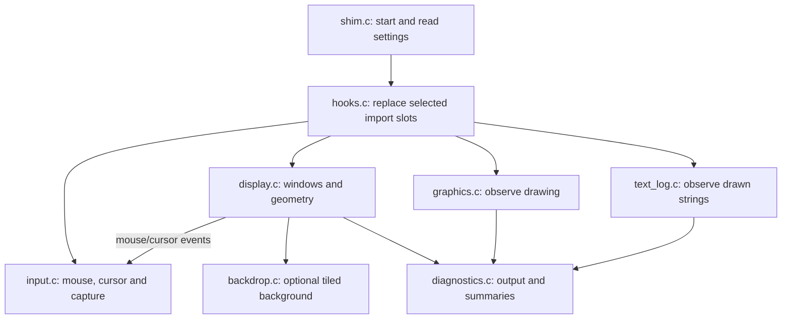

# How the display shim works

Start here if you know C but have not worked with Windows GUI programs.
The aim is to explain the program's decisions and the Windows concepts behind
them, so the source can be read without first learning MFC.

## What this program changes

Imperialism draws its original, small game view into its own Windows windows.
This shim leaves that drawing in place. It creates a second, larger window and
asks Windows to show a scaled copy of the original inside it. It then translates
mouse input from the larger window back into the game's original coordinates.

There are therefore two views of the same game:

- The **game frame** is the real window that the game already understands.
- The **mirror** is the resizable presentation window that the player sees.

This changes presentation, not game rules or map size. Enlarging the mirror does
not reveal additional tiles or create higher-resolution game artwork.

The display shim is C using the Windows SDK. **It does not use or link MFC.**
Imperialism itself uses MFC and an Ambit framework, but the shim does not call
their C++ classes. It deals with the Windows handles and messages beneath them.
For example, `AmbitGameWindow` is a window-class name the shim searches for,
not a C++ type it needs to include.

The music replacement is a separate component. Nothing in this guide's display
path decodes Ogg music or implements the WINMM music wrapper.

## The Windows vocabulary used in the source

| Term | Meaning here |
|---|---|
| DLL | A library loaded into the game's process. Its code runs inside that process. |
| Proxy DLL | A replacement with the filename the game expects. It adds behavior and forwards the original function the game still needs. |
| HWND | An opaque Windows handle identifying a window. It is not a pointer to an MFC object. Windows APIs use it to find the real object. |
| HMODULE | A handle to an executable/DLL module already loaded into the process. |
| Resource | A named or numbered data item stored inside an executable/DLL, such as a bitmap or icon. Reading a bitmap resource is not calling the game's code. |
| Window class | A registered recipe for creating a kind of window: its message handler, default cursor, icon and similar properties. It is unrelated to a C++ `class`. |
| Client area | The inside of a window where application content appears, excluding its title bar and resize border. |
| Non-client area | The title bar, borders and other window decorations managed by Windows. |
| Message | A numbered event such as “mouse moved,” “window resized” or “please choose a cursor.” |
| Window procedure | A callback that Windows calls to deliver messages to a window. Its conventional type is `WNDPROC`. |
| UI thread | The thread that created a window and runs its message handling. The game's existing UI thread also owns the mirror. |
| Focus | The window that receives keyboard input. It is different from mouse capture. |
| Mouse capture | A request to keep receiving mouse events even after the pointer leaves a window, useful during a drag. |
| HDC | A drawing context: a Windows handle carrying a drawing destination and settings such as mapping, colors and selected objects. |
| GDI | Windows' older drawing API: bitmaps, lines, text, palettes and brushes. |
| HBITMAP / HBRUSH | Handles to a bitmap image and a painting brush. A pattern brush repeats a bitmap. |
| DWM | Desktop Window Manager, Windows' desktop compositor. Its thumbnail API supplies the scaled game image. |
| IAT | Import Address Table: executable slots holding addresses of functions imported from DLLs. |
| Hook | Here, a wrapper substituted into one of those import slots. It is not a patch to the game's source or rendering algorithm. |

Three message parameters deserve special attention. `message` identifies the
event. `wParam` and `lParam` carry event-specific data; they are not always
pointers or always coordinates. For a mouse message, `wParam` contains button
flags and `lParam` packs X/Y. In other messages, the same integer-sized slots
may carry a handle or a pointer to a structure. Each case must interpret them
according to that message's contract.

## The modules and a useful reading order

The display DLL is built from small C modules. Headers state their interfaces;
file-local state stays with the subsystem that owns it.

| Read | File | Responsibility |
|---|---|---|
| 1 | [shim.c](../src/shim.c) | DLL startup, configuration and forwarding the required system MSVFW32 export. |
| 2 | [display.c](../src/display.c) | The window pair, image geometry, menus/focus and six placement/display wrappers. |
| 3 | [input.c](../src/input.c) | Mouse routing, synthetic cursor, capture and six input wrappers. |
| 4 | [backdrop.c](../src/backdrop.c) | Load and tile the game's optional original background; fall back to brown. |
| 5 | [hooks.c](../src/hooks.c) | Describe and replace selected executable import slots. |
| 6 | [graphics.c](../src/graphics.c) | Observe 13 GDI and four painting/DC APIs; forward them unchanged. |
| 7 | [text_log.c](../src/text_log.c) | Record four eligible text-drawing APIs without changing them. |
| 8 | [diagnostics.c](../src/diagnostics.c) | Serialize output and periodically report hook counts/state. |



The diagram groups responsibilities; it is not a separate thread per box.
Drawing and input still happen through the game's calls and Windows' message
delivery. Only periodic diagnostic summaries need a background worker.

### How the files communicate

[shim_internal.h](../src/shim_internal.h) is the private contract between these
files. These C functions are internal to our DLL, not new game-facing exports.

- `DisplayOptions` groups the four display settings. Startup calls
  [display_configure](../src/display.c) to copy them into display-owned state.
- `Hook` describes one imported function: library/name, replacement address,
  saved original address and call count. `HookTable` is a list of these records
  plus its length.
- `graphics_hook_table`, `display_hook_table`, `input_hook_table` and
  `text_hook_table` return their module's records.
  [hooks_patch_executable](../src/hooks.c) collects them and patches the imports.
- [display_frame_window](../src/display.c) and
  [display_mirror_window](../src/display.c) return HWND values. Input can use
  them without gaining direct access to the display module's private variables.
- [display_map_point](../src/display.c) supplies the shared image-to-game
  conversion. It may refresh the cached crop/thumbnail fit if the view changed.
- The display callback calls [input_relay_mouse](../src/input.c),
  [input_relay_cursor](../src/input.c) and
  [input_mouse_leave](../src/input.c) for input events.
  [input_has_mirror_capture](../src/input.c) tells deferred focus handling when
  the mirror is still being used for a drag/capture.
- [text_log_open](../src/text_log.c) opts into drawn-text capture.
  [diagnostics_log](../src/diagnostics.c) writes general diagnostic lines.
  Both file paths use the logging lock supplied by diagnostics.
- [diagnostics_write_summary](../src/diagnostics.c) asks
  [display_write_diagnostics](../src/display.c) for current geometry and
  [hooks_write_counts](../src/hooks.c) for import/counter rows.

State follows those responsibilities. `display.c` owns `game_frame`,
`mirror_window`, `source_rect`, `destination_rect` and fullscreen/menu state.
`input.c` owns `game_capture_target`, `virtual_cursor_position`, capture
flags and `child_drag`. The text module owns its recent-string ring; diagnostics
owns the output lock and worker. Splitting the files does not introduce extra
UI threads or move game state into a new framework.

## Follow the program from startup

### 1. The game loads our proxy

The installed display file is named `msvfw32.dll` beside `Imperialism.exe`.
The game expects that DLL name and imports `MCIWndCreateA` from it. Our proxy
provides that export and uses DLL startup to initialize its compatibility work.

[DllMain](../src/shim.c) is the Windows callback for attach/detach notifications.
On process attach, startup initializes/opens diagnostics, attempts DPI awareness
and installs the import wrappers. It then reads adjacent
`imperialism_shim.ini` options, passes display settings to `display_configure`,
optionally opens the text log, and starts the summary worker. Configuration is
read once; editing the INI while the game runs does not reload it.

The supported switches are:

- `[display] fullscreen_integer_scale=1`: use whole-number fullscreen enlargement
  where it fits. The source can still shrink fractionally on a smaller display.
- `[display] block_mode_change=1`: preserve the desktop resolution while reporting
  success to the game's display-mode requests.
- `[display] brown_titlebar=1`: request a matching dark/brown caption on supported
  Windows versions. This is independent of image scale and the tiled backdrop.
- `[display] original_backdrop=1`: enable the optional original tile, with brown
  as the failure/disabled fallback.
- `[text_log] enabled=0`: drawn-text capture is off unless explicitly enabled.

The exported [MCIWndCreateA](../src/shim.c) still has a real job. It loads the
Windows system copy of MSVFW32 by an explicit system-directory path and calls
the real export. An explicit path avoids finding this proxy again. It caches
the resolved function for the process lifetime and returns NULL if resolution
fails. Its calling convention and export definition must remain compatible with
the game's caller.

### 2. An import slot redirects a call

Suppose the executable normally calls `CreateWindowExA` through an import slot:

```text
Before: game → IAT slot → USER32 CreateWindowExA
After:  game → IAT slot → our wrapper → saved USER32 function
```

The [hook installer](../src/hooks.c) walks the main executable's named imports.
For a registered DLL/function pair, it temporarily makes the slot writable,
saves its original address, stores the wrapper address, then restores page
protection.

A wrapper can inspect arguments, apply a narrow compatibility rule and call the
saved original. Many wrappers simply log and forward.

This distinction prevents recursion: **the executable's imports are patched;
the shim's own imports are not.** A normal `SetCapture` call made inside our
C code reaches Windows directly. A `SetCapture` call made through the game's
patched slot reaches our wrapper.

The installer handles ordinary named imports in the main 32-bit executable.
It does not rewrite every DLL in the process or intercept arbitrary
`GetProcAddress` lookups, delay imports or ordinal-only imports.

### 3. Find the game frame and create the mirror

The [CreateWindowExA wrapper](../src/display.c) forwards creation first, then
recognizes the first successful unowned top-level window titled exactly
`Imperialism`. A string class name is required by this discovery path.

[mirror_init](../src/display.c) creates an owned top-level
`ImperialismMirror` window on that same UI thread. “Owned” has a particular
Windows meaning: the mirror stays above its owner and follows its minimize
visibility. It does **not** mean that the mirror is a child drawn inside the
game frame. This arrangement also avoids a second independent taskbar window.

The real frame remains underneath at its normal size. Keeping it normal matters:
the game still computes layouts and queries child positions using its original
window. The mirror provides room to scale without asking the game to understand
a larger playfield.

The shim also **subclasses** the original frame: it saves the game's window
procedure and substitutes a small wrapper. Subclassing here means inserting a
callback before/after the existing handler, not deriving an MFC class.
[frame_window_proc](../src/display.c) calls the original procedure and then applies the
size constraint needed to keep the real frame covered.

### 4. Wait for a usable view, then fit it

The game briefly creates a frame with provisional dimensions. The shim therefore
defers first layout until it has a plausible game view.

[refresh_src](../src/display.c) looks for the frame's `AmbitGameWindow` child.
It maps that child's rectangle into frame-client coordinates and clips it to
the frame client. Before the child exists, it uses the frame client itself.

[mirror_layout](../src/display.c) chooses an initial integer scale, adds room
for the mirror's title bar/menu/borders, and centers it in the work area. It
records the real frame's normal **outer** dimensions for later constraints.

[mirror_update](../src/display.c) handles ongoing fitting. It preserves the
game image's aspect ratio and centers it in the mirror client. A DWM thumbnail
connects the source frame/crop to that destination rectangle. Windows, not a
replacement BitBlt loop, produces the enlarged image.

[mirror_place_frame](../src/display.c) parks the frame's outer top-left at
the mirror's client origin in screen coordinates. Client and outer origins
differ because window borders/title bars occupy space.

## A worked coordinate example

There are four relevant coordinate systems:

1. **Mirror client:** where the player clicked inside the enlarged presentation.
2. **Frame client:** the game's original unscaled coordinates.
3. **Target client:** coordinates relative to the specific child receiving input.
4. **Screen:** desktop coordinates used by cursor and non-client APIs.

The private `source_rect` in `display.c` is a crop in frame-client coordinates.
`destination_rect` is the fitted image rectangle in mirror-client coordinates.
They are
two descriptions of the same image at different scales.

Assume a 640×480 source and a 1920×1080 fullscreen mirror. With integer scaling,
2× is the largest fit. The image becomes 1280×960, leaving margins:

```text
source_rect      = (0, 0) to (640, 480)
destination_rect = (320, 60) to (1600, 1020)

player clicks mirror point (520, 260)
subtract the margin:       (200, 200)
divide by scale 2:         (100, 100) in the game frame
```

If the target child begins at frame point (80, 60), that child's handler receives
(20, 40). Passing (520, 260) straight to it would select the wrong control.

[display_map_point](../src/display.c) performs the first conversion using the actual
source/destination rectangles. [resolve_target](../src/input.c) finds the
child and converts the point into that child's client coordinates.

The game's cursor queries must agree too. If the real frame's client origin is
screen point (1000, 500), the mapped frame point (100, 100) becomes **synthetic
screen point (1100, 600)**. The cursor wrappers report that point to the game.
They do not physically move the desktop cursor away from the enlarged image.

Raw X/Y logged by a text-drawing wrapper are a different matter: they belong to
the supplied drawing context's mapping, not automatically to any of these four
window coordinate systems.

## Follow one mouse click through Windows

Windows delivers messages by calling a window procedure. Our mirror procedure,
[mirror_window_proc](../src/display.c), is therefore entered by the operating system;
the shim does not poll for clicks in a loop.

The game already runs a message loop: it retrieves queued events and asks Windows
to dispatch them. For an ordinary queued mouse event, the route is:

```text
mouse event → thread queue → game's message loop
            → Windows dispatch → mirror_window_proc
```

We reuse that loop because the mirror belongs to the same UI thread. Resizing is
another event: `WM_SIZE` recomputes the image fit. `InvalidateRect` asks Windows
to repaint the background later; it does not render the enlarged game itself.
DWM keeps composing the game image independently.

For an ordinary left-button click, [input_relay_mouse](../src/input.c) does this:

1. Map the mirror point into the original frame. A border-only click is ignored
   unless an existing drag/capture needs to continue there.
2. Update the synthetic cursor **before** delivering the event. The game's event
   handler may immediately ask where the cursor is.
3. Find the deepest visible game child under the point, unless the game already
   requested capture to a particular child.
4. Acquire physical mouse capture on the mirror when needed.
5. Send the mouse message to the game child using the converted child coordinates.
6. On release, stop capture when neither the game nor another held button needs it.

The core handoff looks like:

```c
SendMessageA(target, message, buttonState,
             MAKELPARAM(targetPoint.x, targetPoint.y));
```

`MAKELPARAM` packs X/Y into the format Windows expects. `SendMessageA` is
**synchronous**: it runs the target's handler before returning. That handler may
be implemented by the game's MFC/Ambit machinery, but the shim does not need to
know its C++ class. It asks Windows to deliver the event to the HWND.

Synchronous delivery also explains why state must be ready first. The target
can call a hooked cursor/capture API before the outer mouse wrapper returns.

### Why two capture states exist

Without capture, moving out of a window during a drag could stop its events.
The player is physically using the mirror, so Windows capture must belong to
the mirror. The game, however, expects its own slider/view/dialog HWND to be
the capture owner.

The input module keeps both meanings:

- **Physical capture:** the mirror HWND registered with Windows.
- **Logical capture:** the game HWND remembered for its own capture queries.

The game's `SetCapture` wrapper stores its requested target and captures the
mirror physically. `GetCapture` returns the logical target. While it is valid,
target resolution chooses it even when the mapped point has moved outside its
rectangle. `ReleaseCapture` clears that state and releases Windows capture.

### Captions, close buttons and cursors

A child dialog's title bar is outside its client area. The shim asks Windows
for a `WM_NCHITTEST` result at the synthetic screen position before treating
it like a client click.

Caption hits start a manual drag, storing the initial press and window position.
The close button records the pressed child and closes only if release is over
that same close button. This is a small emulation of the specific game behavior;
it is not a complete implementation of Windows non-client interaction.

For `WM_SETCURSOR`, the mirror asks the mapped game child to select a cursor.
It keeps whatever cursor the game's handler set, even if the handler's return
value is false. Unused background gets the ordinary arrow.

## Keyboard focus, menus and fullscreen

Mouse capture does not determine keyboard focus. The mirror usually hands
keyboard focus back to the game frame so the game's existing shortcuts continue
working. It defers that handoff with a private posted message rather than forcing
focus changes in the middle of every focus notification.

`PostMessageA`, unlike `SendMessageA`, queues work for later. The deferred
focus handler rechecks whether a menu or capture now needs focus before acting.

The mirror reuses the game's menu handle. Menu preparation/selection and command
messages are forwarded to the original frame; a menu loop temporarily suspends
the focus handoff.

A UI-thread `WH_GETMESSAGE` hook watches messages removed from the queue. It
consumes F11 and Alt+Enter key-down messages to toggle fullscreen, ignoring
autorepeat. This is a thread-local Windows hook, not a global keyboard listener.

Two different mechanisms are called a “hook” here. The IAT wrappers replace
imported API addresses. `WH_GETMESSAGE` is a Windows-provided callback for
watching queue retrieval. Only the latter handles these fullscreen shortcuts.

Fullscreen means a borderless mirror covering its nearest monitor. The shim
saves/restores the windowed style, menu and outer rectangle. It does not need to
change the desktop's display mode. The display-mode wrapper can report success
to the game while leaving the actual mode alone.

There are also two different minimize paths:

- The game sometimes minimizes itself after losing focus. Its patched calls
  are suppressed once the mirror exists.
- The user minimizing the mirror should still work. That path calls the shim's
  own unpatched API to minimize the owner frame and its owned mirror.

This difference is intentional compatibility policy.

## The backdrop is separate from the scaled image

[backdrop.c](../src/backdrop.c) supplies the optional original crown/shield/swords
tile. The UI thread reads bitmap resource 281 from the **running game's
executable module**. No game artwork is required for building or distributed
with the shim. See [backdrop.md](backdrop.md) for the evidence and resource checks.

`backdrop_load` validates the known 128×128 uncompressed 8-bit bitmap and creates
a bitmap/pattern brush. `backdrop_paint` paints solid brown first, then tiles the
pattern at native size if available. `backdrop_free` releases the objects it owns.

The game image can be scaled 2× while the background still repeats at 128×128.
These are independent jobs: changing the background must not change image bounds
or mouse conversion. Missing/invalid artwork, or `original_backdrop=0`, leaves
the brown fallback.

## Why so many drawing wrappers merely forward

[graphics.c](../src/graphics.c) observes operations such as BitBlt, bitmap
creation, palette selection and line drawing. Most wrappers record selected
arguments and call the original function with the same arguments/result.

Their presence does not mean the shim reimplements GDI. They are probes used to
understand what the game asks Windows to draw. DWM supplies the presentation scale
after the game has done its own drawing.

Similarly, [text_log.c](../src/text_log.c) taps ANSI text-drawing functions.
With text logging enabled, it records requested strings and positions before
forwarding the real draw call. Glyph-index payloads and layout-only DrawText
calls are excluded because they are not visible string requests.

The logger captures at most 400 bytes, normalizes control whitespace and keeps
a 128-entry ring of text/position hashes. An equal hash within 1.5 seconds is
suppressed. API kind and drawing context are not in the hash, so distinct draws
can merge; the hash can also collide. It is useful for a test harness reading
labels, but it is not OCR or an accessibility tree. A logged request does not
prove the API succeeded or that the text was visible.

## Threads, diagnostics and resource lifetime

Keep the window pair, coordinate rectangles, focus and capture state together
on the UI thread. The game and mirror share that thread, so synchronous input
delivery does not require inventing a second GUI message loop.

[diagnostics.c](../src/diagnostics.c) supplies serialized file output and a
periodic summary worker. Logging synchronization does not make all window state
thread-safe; a diagnostic geometry report is not a transactional snapshot of
the UI.

The summary's rows are grouped by module: graphics, display, input, then text.
There are 17, 6, 6 and 4 registered hooks respectively, for 33 in total.
This is table order, not the order in which calls happened. Matching still uses
the same DLL/API names; file extraction did not add new interception targets.

Hook counters also need careful interpretation. Some wrappers count/log their
first calls; cursor and window-procedure diagnostics use different limits.
Not every hooked API increments a counter. A zero counter is not proof that the
API was unused.

The general log is `imperialism_gdi_log.txt`; optional drawn text goes to
`imperialism_text.log`. They are beside the DLL and truncated at startup.
Failed opens skip output. Files require a writable directory, and the current
logger has no rotation or total-size bound.

The DLL is designed to remain loaded for the game's process lifetime. Normal
mirror destruction unregisters the DWM thumbnail and frees backdrop objects.
It is not a supported hot-unload library: detach does not comprehensively undo
import patches, subclassing, hooks, worker lifetime and every cached resource.

## Reading the C without guessing at platform syntax

- `CALLBACK` and `WINAPI` specify calling conventions used by Windows.
  Preserve them when moving functions; they affect how a 32-bit caller/callee
  agree to pass arguments and clean the stack.
- `const TYPE *` in a wrapper often means Windows supplies an input structure;
  `TYPE *` may be an output parameter. Read the function contract before changing it.
- A saved API address must be called through the correct function-pointer type.
  Those casts describe the API signature; they are not converting a bitmap or
  changing game data.
- `WM_*` constants identify messages. A large message `switch` groups events
  handled by one window; unhandled events go to Windows' default procedure.
- `GetClientRect` measures the drawable inside; `GetWindowRect` measures the
  outer window in desktop coordinates. Mixing those rectangles causes offsets.
- `MapWindowPoints` converts coordinates between window origins. It is not
  applying the mirror's scale; the explicit image mapping does that first.
- `SetWindowPos` changes geometry/placement. Flags can request “do not resize”
  or “do not activate,” so all its arguments must be read together.
- `GetModuleHandleW(NULL)` refers to the running executable module. The `A`/
  `W` suffixes distinguish narrow-byte and wide-character Windows API variants.

The wrapper pattern in [graphics.c](../src/graphics.c) can be read one step at a
time. This is the original-function part of the line-drawing wrapper:

```c
typedef BOOL (WINAPI *OriginalFunction)(HDC, int, int);
OriginalFunction original =
    (OriginalFunction)hook_LineTo.original;

return original(deviceContext, endX, endY);
```

The `typedef` names the type “pointer to the Windows LineTo signature.”
The next statement treats the saved address as that callable type.
The final statement calls the real API; the shim has not invented new line
drawing. Other wrappers use the matching signature for their own API.

Only two small convenience macros remain in
[hook_support.h](../src/hook_support.h): `DECLARE_HOOK` creates a named
descriptor, and `LOG_HOOK` counts/logs its first 40 calls. They do not hide
the original function call. The `#` operator makes an API name into a string;
`##` joins tokens to form an identifier such as `hook_LineTo`.

Short names are not required by Win32. Parameters and local state should name
their role and coordinate space. The few conventional Windows types/constants
that remain should be explained where their behavior matters, rather than
assuming every reader already knows them.

## Limits and verification

The current implementation is specific to the 32-bit GOG Windows executable:

- It assumes a particular frame title and view class, one game/mirror pair,
  and the game's observed startup/placement behavior.
- DWM must supply the thumbnail. There is no software image fallback.
- DPI awareness is legacy process-wide setup, not complete per-monitor DPI handling.
- Explicit mouse routing covers left/right/middle buttons, not wheel, X-button,
  touch or every capture-cancellation path.
- Separate popups outside the source frame, unusual modal loops and extreme
  screen coordinates need their own validation.
- The presentation worker/reporting design does not establish safe explicit
  `FreeLibrary` unloading.

Build/check commands remain:

```powershell
python -I build.py
python -I tools/test_display.py
```

Native tests check DLL shape, interception/text logging and synthetic backdrop
behavior. They do not prove correct real-game input/focus/fullscreen or audible
music. Use [STATUS.md](STATUS.md) for the evidence actually obtained and
[README.md](../README.md) for current build/install/release instructions.
In-game acceptance must restore installed DLLs, INIs/settings and a stopped game
even when a test fails.

For a presentation change, trace both directions: **which original pixels does
Windows show, and which original game point does a player action reach?**
Keeping those two answers consistent is the central constraint of this shim.
