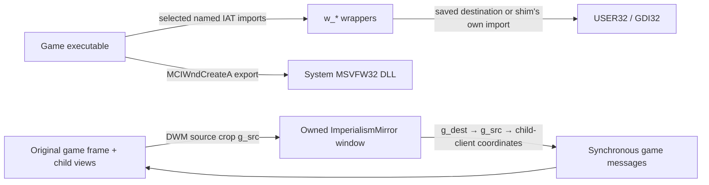

# Display shim developer guide

This describes the display component in [src/shim.c](../src/shim.c). The separate
WINMM music component has its own source and decoder dependencies. The display
shim is a **32-bit, process-lifetime MSVFW32 proxy** developed against the GOG
Windows build of Imperialism. Its main job is to present the original game view
at a useful size while preserving the game's own rendering and event handlers.

The source now uses descriptive local and parameter names. That naming/comment
cleanup preserves public entry points, calling conventions, hook order, calculations
and existing input dispatch. The optional stock backdrop and missing-log guard are
separate behavior changes described below.
This guide explains the implementation and its limits; it is not a claim that every
path has been exercised in the real game. Current test evidence is in
[STATUS.md](STATUS.md).

## Read the system in this order

1. [DllMain](../src/shim.c#L1038) and [patch_iat](../src/shim.c#L955): startup and the interception boundary.
2. [w_CreateWindowExA](../src/shim.c#L678), [mirror_init](../src/shim.c#L459),
   [mirror_show](../src/shim.c#L540) and [mirror_layout](../src/shim.c#L500): discover and present the game.
3. [refresh_src](../src/shim.c#L106) and [mirror_update](../src/shim.c#L124): choose the crop and fitted image.
4. [MirrorProc](../src/shim.c#L323), [mirror_mouse](../src/shim.c#L257), [map_point](../src/shim.c#L221) and
   [resolve_target](../src/shim.c#L237): turn scaled-window input back into game input.
5. The USER32 wrappers: make the game's cursor, capture and placement queries
   agree with that input.
6. Text/diagnostic logging and [MCIWndCreateA](../src/shim.c#L1082): observability and the
   original DLL function that still has to work.



The drawing wrappers are observers. They do not scale the game's BitBlt calls,
rebuild its palettes, enlarge its backing bitmaps or increase the map viewport.
Windows DWM composes a thumbnail of the original frame into the presentation
window. A failed thumbnail registration currently has no software fallback.

## Files and external contracts

| Item | Contract |
|---|---|
| `src/shim.c` | Proxy export, executable IAT hooks, presentation window, input mapping and diagnostics. |
| `src/backdrop.c` / `src/backdrop.h` | Optional native-size stock bitmap tiling, validation and owned GDI resources. |
| `src/msvfw32.def` | Export definition used by the build; preserve the proxy's required symbol/ABI. |
| `build.py` | Builds the i386 display DLL; it does not install into the game directory. |
| `tools/test_display.py` | Native process-lifetime smoke cases and DLL/import/export checks. |
| `imperialism_shim.ini` | Startup configuration beside the DLL; edits require a new game process. |
| `imperialism_gdi_log.txt` | General diagnostic file, truncated when this DLL attaches. |
| `imperialism_text.log` | Optional ANSI drawing-text log, also truncated on attach. |

The proxy is loaded as `msvfw32.dll` beside `Imperialism.exe`. Only the
executable's selected imported functions are redirected. Imports belonging to this
shim or other DLLs are not patched. That distinction is essential: a helper's
ordinary `SetCapture`, `ShowWindow`, `GetCursorPos` or `SetCursor` call reaches
Windows directly and does not recursively enter the game's replacement wrapper.

[MCIWndCreateA](../src/shim.c#L1082) lazily loads `msvfw32.dll` using an explicit path from
`GetSystemDirectoryA`, then resolves and caches `MCIWndCreateA`. It preserves
the existing `__cdecl` declaration and returns NULL if resolution fails. It does
not forward every MSVFW32 export, and it does not emulate CD audio; music belongs
to the separate WINMM proxy. The cached system module is retained for process
lifetime.

## Coordinate spaces: keep them separate

| Space | Meaning and users |
|---|---|
| Frame client | Original unscaled game coordinates relative to `g_frame`'s client origin. `g_src` is a crop rectangle in this space. |
| Mirror client | Pixels relative to `g_mirror`'s client origin, excluding its non-client frame/menu. `g_dest` is the fitted image rectangle here. Mouse messages arriving at the mirror use this space. |
| Target client | Coordinates relative to the resolved game child HWND. `resolve_target` converts its argument in place from frame client to this space. |
| Screen | Desktop coordinates used by window placement, `WM_NCHITTEST` and cursor APIs. `g_savedRect` stores an outer window rectangle in this space. |
| Drawing DC | Coordinates passed to an intercepted drawing API. They belong to that HDC's mapping; the text log does not convert them into mirror or screen coordinates. |

Startup calls `SetProcessDPIAware`, attempting legacy process DPI awareness.
There is no per-monitor-v2 setup or `WM_DPICHANGED` handler. Do not interpret the
implementation as a completed mixed-DPI/multi-monitor solution.

For a mirror point `(mx, my)`, [map_point](../src/shim.c#L221) computes:

```text
frameX = g_src.left + MulDiv(mx - g_dest.left, sourceWidth, destinationWidth)
frameY = g_src.top  + MulDiv(my - g_dest.top,  sourceHeight, destinationHeight)
```

The return value reports whether the original mirror point lies in the image,
using left/top-inclusive and right/bottom-exclusive bounds. The output point is
still extrapolated outside that rectangle, allowing an existing drag or capture
to continue into the border. These are integer Win32 mappings; message packing
still has Win32's signed 16-bit coordinate limitations.

`g_virt` is **synthetic screen position**: the mapped frame-client point plus the
real frame's screen origin. It is deliberately not the physical cursor's location
on the enlarged mirror. The game's hooked cursor APIs expose this synthetic point
while `g_virtActive` is set.

## State and thread ownership

The window/mapping/capture state is intended to be owned by the frame's UI thread.
The mirror is created inside that thread's intercepted window creation, so its
procedures and synchronous messages run there too. There is no independent render
thread. A separate worker prints summaries every five seconds.

| State | Meaning |
|---|---|
| `g_frame`, `g_frameProc` | Original game frame and its saved procedure for subclass chaining. |
| `g_mirror`, `g_thumb` | Owned top-level presentation HWND and its DWM thumbnail registration. |
| `g_src`, `g_dest` | Frame-client crop and mirror-client fitted image rectangle. |
| `g_frameW/H`, `g_laidOut` | Normal frame **outer** size recorded once valid initial layout succeeds. |
| `g_shown` | One-time thumbnail/show setup has been requested; it is not an up-to-date visibility query. |
| `g_fullscreen`, `g_savedStyle`, `g_savedRect`, `g_menu` | Presentation mode, saved windowed style/outer rectangle, original menu handle. |
| `g_originalBackdrop`, `g_backdrop` | Startup opt-in and optional bitmap/pattern objects loaded and freed by the UI thread. |
| `g_capTarget` | Logical game capture HWND, distinct from physical Windows capture. |
| `g_mirrorCap` | Shim expects the mirror to hold physical capture. |
| `g_virt`, `g_virtActive` | Mapped synthetic screen cursor and whether the game should see it. |
| `g_tracking` | A mirror mouse-leave notification has been requested. |
| `g_inMenu`, `g_inSetCursor` | Focus deferral during menus, and a diagnostic cursor-dispatch marker. |
| `g_drag.window/startFramePoint/startFramePosition/active` | Manually dragged game child, initial frame-client press point and original outer top-left. |
| `g_closeDown` | Game child whose non-client close button was pressed. |
| `g_msgHook` | UI-thread `WH_GETMESSAGE` registration for fullscreen shortcuts. |
| `g_log`, `g_text`, `g_cs` | Output streams and lock shared by diagnostic/text writes. |
| `g_recent`, `g_recentN` | Text hash/tick suppression ring and next insertion index, protected by `g_cs`. |
| `Hook.count` | Atomic per-wrapper diagnostic counter, where that wrapper increments it. |

`g_cs` protects log writes and the text ring. It does **not** serialize the
presentation state. [summary_thread](../src/shim.c#L1027) queries window geometry and reads
UI-owned caches through [diag](../src/shim.c#L993) without a consistent state snapshot;
its report can combine adjacent UI states. IAT wrappers run on whichever
executable thread calls them, so extending their state mutation to additional
threads requires a new ownership design.

## Startup, window discovery and layout

[DllMain](../src/shim.c#L1038) initializes the critical section, disables DLL thread
notifications, opens the general log, attempts DPI awareness, initializes the
hook table and patches the executable IAT. It then reads adjacent INI settings,
opens the optional text log and starts the summary worker. The settings are:

| Setting | Default | Effect |
|---|---|---|
| `[display] block_mode_change` | 1 | Report success for game display-mode requests without changing the desktop. |
| `[display] fullscreen_integer_scale` | 1 | Floor fullscreen scales of at least 1 to a whole number. |
| `[display] brown_titlebar` | 1 | Request dark/brown DWM caption attributes where supported. |
| `[display] original_backdrop` | 1 | Tile the running game's stock bitmap resource behind the image; fall back to brown. |
| `[text_log] enabled` | 0 | Open the text log and capture eligible ANSI drawing calls. |

The initial defaults also exist as global initializers. Configuration is read
once; there is no live reload.

[w_CreateWindowExA](../src/shim.c#L678) first calls the saved real function. The first
successful window with no parent, a string class name and the exact title
`Imperialism` becomes `g_frame`. This is a specific discovery heuristic, not a
general MFC window finder. A class atom is logged numerically and does not trigger
discovery.

[mirror_init](../src/shim.c#L459) registers `ImperialismMirror` with double-click support
and creates a hidden, owned, top-level `WS_OVERLAPPEDWINDOW`. Passing the frame
as owner keeps the mirror above it and avoids a second independent taskbar
window. It requests caption/border/text colors, saves/replaces the frame's
procedure and installs a thread-local message hook. The numeric DWM caption
attributes are best-effort requests; unsupported Windows versions can ignore them.

[mirror_show](../src/shim.c#L540) registers the thumbnail once and either shows an already
laid-out mirror or asks layout to finish. `g_shown` prevents duplicate setup.
Layout is deferred because the game briefly creates its frame with implausible
startup dimensions before settling to its normal view.

[mirror_layout](../src/shim.c#L500) waits for a source crop of at least 320×200, records the
normal frame outer size, reuses its menu handle, then finds the largest scale
from 6 down to 1 that fits `SPI_GETWORKAREA`. It adds mirror decorations/menu via
`AdjustWindowRect`, centers the result, parks the underlying frame and updates
the thumbnail. It does not recompute this initial choice on every resize. Its
work-area query is the primary work area, unlike fullscreen's nearest-monitor
choice.

[refresh_src](../src/shim.c#L106) prefers the direct `AmbitGameWindow` child, maps its
window rectangle into frame-client coordinates and intersects it with the
frame client. Before that child exists it uses the whole frame client. It does
not add separate owned popup windows outside the frame to the DWM source.

[mirror_update](../src/shim.c#L124) fits that crop into the current mirror client while
preserving aspect ratio and centers it. In fullscreen, integer scaling applies
only when the fit is at least 1; smaller displays can still use fractional
downscaling. It sends DWM an opaque, visible, source-client-only thumbnail with
both source and destination rectangles. Unused image margins show the optional
stock tiled backdrop, with solid `RGB(84,46,8)` as the fallback; title tint remains
independent of background painting.

[mirror_place_frame](../src/shim.c#L162) positions the real frame's **outer** top-left at
the mirror's **client** screen origin without resizing or activating it. This is
why its origin calculation uses `ClientToScreen`, rather than the mirror's
outer window rectangle.

## Optional original tiled backdrop

The optional background is decorative and separate from DWM/input geometry.
[backdrop.h](../src/backdrop.h) defines `Backdrop` with an owned `HBITMAP`
and pattern `HBRUSH`. See [backdrop.md](backdrop.md) for the resource evidence and
dedicated tests.

`mirror_init` requests `backdrop_load(&g_backdrop, GetModuleHandleW(NULL))`
on the UI thread, after startup and outside `DllMain`. It reads resource 281 of
type `RT_BITMAP` from the **running game's executable module**. It does not
load game artwork at build time or ship a bitmap in the release.

- [backdrop_load](../src/backdrop.c#L19) first frees any prior objects, validates
  the stock 128×128 uncompressed 8-bit DIB/header/palette storage, then uses
  `LoadImageW(..., LR_CREATEDIBSECTION)` and `CreatePatternBrush`. Missing or
  mismatched resource data leaves an empty object, and failure after allocation
  frees partial state.
- [backdrop_paint](../src/backdrop.c#L66) fills the mirror client brown first.
  When a pattern exists, it tiles at native size with brush origin (0,0), then
  restores the caller's DC brush color/origin. The tile is not stretched along
  with the game's image.
- [backdrop_free](../src/backdrop.c#L8) deletes only its owned pattern/bitmap and
  zeros the object. `LR_SHARED` is deliberately absent. `WM_DESTROY` calls it;
  it is also safe on an empty/partially initialized object.

With `original_backdrop=0`, or any resource/bitmap/brush failure, the same paint
path remains plain brown. A successful tile load changes neither `g_src` nor
`g_dest`, capture routing, virtual cursor coordinates or title-bar tint.

## Fullscreen, visibility and focus

[mirror_toggle_fullscreen](../src/shim.c#L173) saves the mirror's windowed rectangle/style,
removes its menu, changes it to a visible borderless popup and covers the nearest
monitor. On exit it restores the saved style/menu/rectangle. It updates
`g_fullscreen` after changing geometry, then explicitly refits because the
synchronous `WM_SIZE` ran before that flag changed. This is borderless
presentation, not a request to change desktop resolution.

[msg_hook](../src/shim.c#L203) consumes removed F11 `WM_KEYDOWN` or Return
`WM_SYSKEYDOWN` messages. It ignores autorepeat using bit 30 and replaces the
message ID with `WM_NULL`. The hook is scoped to the UI thread, not a global
keyboard hook. Key-up messages and ordinary game shortcuts remain the game's
responsibility.

[MirrorProc](../src/shim.c#L323) handles the window lifecycle:

| Message/path | Purpose |
|---|---|
| `WM_SIZE`, `WM_MOVE`, restored `WM_SHOWWINDOW` | Refit and/or re-park the underlying frame. |
| `WM_ERASEBKGND` | Paint brown and then the optional native-size stock tile; DWM supplies the fitted game image above it. |
| `WM_GETMINMAXINFO` | Set the mirror's minimum tracking size so it can cover the recorded frame outer size. |
| `SC_MINIMIZE` | Minimize the owner frame using the shim's unpatched API; ownership hides the mirror and retains one taskbar restore path. |
| `WM_SETFOCUS`, private `WM_APP+1` | Defer keyboard focus back to the game frame, unless a menu or capture requires otherwise. |
| Menu-loop messages | Hold focus during menu interaction, then request deferred handoff. |
| `WM_INITMENU`, `WM_INITMENUPOPUP`, `WM_MENUSELECT` | Forward menu preparation/selection to the original frame and continue default mirror handling. |
| `WM_COMMAND`, `WM_CLOSE` | Forward commands/close to the game frame. |
| `WM_SETCURSOR` | Ask the mapped target to choose its cursor; retain whatever it sets, regardless of its return value. Use the arrow over unused background. |
| Mouse move/button/double-click | Route through `mirror_mouse`. |
| `WM_MOUSELEAVE` | Clear leave tracking and disable synthetic cursor coordinates unless capture remains. |
| `WM_DESTROY` | Unregister the thumbnail and release the owned backdrop bitmap/pattern. |

[FrameProc](../src/shim.c#L439) always chains to the original frame procedure first. After
`WM_GETMINMAXINFO`, it limits maximize/max-track sizes to the recorded normal
outer dimensions. This complements, rather than replaces, the API placement
hooks.

## Mouse routing, capture and child-window non-client behavior

[mirror_mouse](../src/shim.c#L257) follows this sequence:

1. Convert the mirror point to frame-client coordinates. Ignore background-only
   input unless logical capture, mirror capture or a manual drag is already active.
2. Request mouse-leave tracking if needed. Update `g_virt` before forwarding;
   a synchronous game handler may query the cursor immediately.
3. If manually dragging a game child's caption, move the child by the delta from
   the initial press. Release the drag on left-button-up.
4. Otherwise resolve the logical capture target or deepest visible child, converting
   to its client coordinates.
5. For uncaptured child non-client hits, send `WM_NCHITTEST` with synthetic screen
   coordinates. A caption press starts the manual drag; a close-button press records
   the target. A release over the same close button posts `SC_CLOSE`.
6. Acquire physical mirror capture for ordinary button-down if no window owns it,
   then synchronously send the original mouse message to the target with mapped
   client coordinates.
7. On button-up, release mirror capture only when the game holds no logical capture
   and no left/right/middle button remains down.

[resolve_target](../src/shim.c#L237) honors a valid `g_capTarget` first. Otherwise it
descends with `ChildWindowFromPointEx(..., CWP_SKIPINVISIBLE)`. It does not
explicitly filter disabled or transparent children. The point passed by pointer
changes coordinate space during this walk.

The virtualized USER32 capture/cursor functions must agree with this routing:

| Function | Behavior |
|---|---|
| [w_SetCapture](../src/shim.c#L799) | For the frame/its descendants, save the logical requested target and capture the mirror physically; return the previous logical target. Other HWNDs use real capture. |
| [w_ReleaseCapture](../src/shim.c#L813) | Clear logical capture flags and release physical capture. Manual drag/close state is managed separately. |
| [w_GetCapture](../src/shim.c#L820) | Return the logical game target if set; otherwise return real Windows capture. |
| [w_GetCursorPos](../src/shim.c#L826) | Supply `g_virt` when active and the caller supplies a point; otherwise call Windows. |
| [w_GetMessagePos](../src/shim.c#L833) | Supply packed `g_virt` while active; otherwise report the real queued-message cursor position. |
| [w_SetCursor](../src/shim.c#L767) | Forward the real cursor change and log whether it occurred inside the mirror's forwarded cursor query. |

The shim currently routes left/right/middle messages. It has no explicit wheel,
horizontal-wheel, X-button, touch or pointer translation. It does not implement
full Windows non-client behavior: child caption/close are special cases. Manual
drag storage assumes a directly frame-parented game child. Capture cancellation
and unexpected capture transfers have no complete `WM_CAPTURECHANGED`/
`WM_CANCELMODE` state-reset path.

## Placement and drawing wrapper inventory

These hooks are entered only through patched executable imports.

| Function | Purpose and return behavior |
|---|---|
| [w_ChangeDisplaySettingsA](../src/shim.c#L660) | If configured, pretend both requested mode changes and restore requests succeeded; otherwise forward unchanged. |
| [w_SetWindowPos](../src/shim.c#L714) | Replace game frame move coordinates with the mirror client screen origin, preserving other arguments/flags; forward, finish deferred layout if needed, then refit. |
| [w_ShowWindow](../src/shim.c#L733) | Swallow frame self-minimize commands after mirror creation; forward other calls, hide the mirror on frame hide, otherwise invoke one-time show setup. |
| [w_MoveWindow](../src/shim.c#L754) | Log the caller address; swallow moves targeting the mirror, forward other targets. It does not itself re-park a frame move. |
| [w_SetWindowPlacement](../src/shim.c#L780) | Use a local copy to rewrite frame maximize as normal; swallow frame minimize; forward remaining cases. |
| [w_GetDC](../src/shim.c#L689) / [w_ReleaseDC](../src/shim.c#L695) | Log and forward acquisition/release of a window DC. |
| [w_BeginPaint](../src/shim.c#L700) / [w_EndPaint](../src/shim.c#L706) | Log paint state and forward; they do not add a paint loop. |
| [w_BitBlt](../src/shim.c#L585) | Log source/destination DCs, geometry and raster operation, then forward. |
| [w_PatBlt](../src/shim.c#L590) | Log destination geometry/raster operation, then forward. |
| [w_StretchDIBits](../src/shim.c#L595) | Log source/destination rectangles and bitmap depth, then forward all data unchanged. |
| [w_CreateDIBSection](../src/shim.c#L603) | Log bitmap metadata, then forward pixel-storage/section arguments unchanged. |
| [w_CreateDIBitmap](../src/shim.c#L610) | Log header and initialization metadata, then forward. |
| [w_CreateCompatibleDC](../src/shim.c#L615) / [w_CreateCompatibleBitmap](../src/shim.c#L621) | Log the requested/created compatible DC or bitmap, then preserve the real result. |
| [w_CreatePalette](../src/shim.c#L626) / [w_SelectPalette](../src/shim.c#L631) / [w_RealizePalette](../src/shim.c#L636) | Observe palette use without changing colors or palette policy. |
| [w_SetStretchBltMode](../src/shim.c#L641) / [w_GetDeviceCaps](../src/shim.c#L646) | Observe selected modes/capabilities; do not spoof them. |
| [w_LineTo](../src/shim.c#L652) | Observe the line endpoint and preserve real drawing behavior. |

Game self-minimize calls and mirror-initiated user minimize are deliberately
different paths. The latter uses this DLL's normal USER32 import, bypassing the
executable IAT hook. Several swallowed calls return a success-like value; those
values are compatibility policy rather than a faithful report of an operation
that Windows performed.

## Import patching and descriptor machinery

`Hook` records imported DLL/symbol, wrapper address, saved destination and a
counter. `DECL` creates one descriptor; `H` names it; `ORIG` casts the saved
destination to the exact API type. [init_hook_table](../src/shim.c#L927) fills wrapper
addresses. `g_hooks` is the common list used by patching and summaries.

[patch_iat](../src/shim.c#L955) reads the main module's DOS/PE headers and ordinary import
directory. It matches DLL names case-insensitively and symbol names exactly,
skips ordinal imports, temporarily makes each matching IAT pointer writable,
saves its old destination and writes the wrapper pointer. It attempts to restore
the old protection afterward. Descriptors whose symbols are absent keep a NULL
saved pointer and are shown as `NOT-IMPORTED`.

This is a PE32-specific one-time patch, not a general injection library:
32-bit ordinal checks, DWORD function pointers, and `GetWindowLongA` procedure
casts must all be revisited for a 64-bit port. It does not patch delay imports,
other modules, dynamically resolved calls or subsequently loaded plugins. The
fallback when `OriginalFirstThunk` is absent assumes usable name data in the
first thunk; do not assume arbitrary bound/import layouts are supported.

## Diagnostic and text logs

[logf_](../src/shim.c#L32) serializes a timestamped formatted line and flushes it.
`LOGCALL` atomically increments a hook counter on each use and emits only the
first 40 detailed lines for that API. `w_MoveWindow` uses the same limit with
its own formatting; `w_SetCursor` emits up to 80. Window procedures have separate
bounded message counters. Capture/cursor-query/text wrappers do not all use
`LOGCALL`, so a hooked API's zero counter does not prove it was never called.

[dump_counts](../src/shim.c#L1011) takes the same log lock, calls [diag](../src/shim.c#L993) and prints
each descriptor's saved-destination status/count. [summary_thread](../src/shim.c#L1027) does
this every five seconds indefinitely; detach asks for one final summary.
Both `logf_` and the periodic summary tolerate a failed general-log open and skip
that output. A writable DLL directory is needed to obtain diagnostic files.

[text_out](../src/shim.c#L851) implements the opt-in text capture:

- Negative length means NUL-terminated; capture at most 400 bytes.
- Replace control bytes below 32 with spaces and trim trailing spaces.
- Hash original bytes and drawing X/Y using an FNV-style rolling hash.
- Under `g_cs`, suppress an equal hash seen within 1500 ms in a 128-entry ring.
- Append and flush `<tick> <kind> <x>,<y> <text>`.

Suppression does not include HDC or API kind and does not compare the full string;
different draws can merge, including rare hash collisions. The hash uses bytes
before whitespace normalization/trimming. Text is ANSI bytes, not guaranteed
UTF-8, not OCR, and not a structured accessibility tree. Shadows or shifted
duplicate strings may remain because their positions differ.

| Tap | Kind | Exclusions |
|---|---|---|
| [w_TextOutA](../src/shim.c#L891) | `T` | None beyond text logger limits. |
| [w_ExtTextOutA](../src/shim.c#L896) | `X` | Skip `ETO_GLYPH_INDEX`, whose payload is glyph indices. |
| [w_TabbedTextOutA](../src/shim.c#L901) | `B` | Logs text/initial position, not expanded tab geometry. |
| [w_DrawTextA](../src/shim.c#L906) | `D` | Skip `DT_CALCRECT` layout-only calls; require a rectangle. |

Every tap preserves its real drawing call and return value. Logging happens
before the call; therefore a log entry is evidence that drawing was requested,
not proof the text became visible or that the original API succeeded.

## Resource lifetime and known limits

This DLL is intended to remain loaded until process termination. Detach prints
counts but does not restore the IAT, frame subclass or message hook; it does not
signal/join the summary worker or comprehensively release files, brushes, menus
and cached modules. Thumbnail and owned backdrop teardown exist in the mirror's
destroy handler.
Do not use explicit `FreeLibrary`/hot unload as a supported lifecycle.

Other limits to preserve in issue reports and future work:

- DWM/window creation and several Win32 calls are best-effort; many failures are
  logged incompletely or ignored. Registration failure can leave an empty mirror.
- Log paths use fixed ANSI `MAX_PATH` buffers; obtaining files requires an adjacent
  writable directory. Failed opens skip output. There is no rotating log or bounded
  total log size.
- Initial sizing and minimize/restore rules are specific to this game's startup
  and frame behavior. `g_shown` is one-time setup; generic repeated hide/show
  lifecycles have not been generalized.
- The physical cursor is not warped by the mapping. Modal loops, outside popups,
  unusual captures, unsupported mouse message types, mixed DPI and extreme
  screen coordinates require separate validation.
- The code runs startup work inside `DllMain` and assumes normal process attach/
  exit. This documentation does not establish loader-lock-safe hot unloading.
- Scaling reproduces the original view; it cannot reveal more map tiles or
  increase original artwork resolution.

## Build, validate and extend

Run the native display checks after changing DLL code:

```powershell
python -I build.py
python -I tools/test_display.py
```

The smoke hosts are process-lifetime tests. Their interception/text/metadata
checks do not demonstrate correct mouse mapping, menus, dragging, fullscreen,
audible music or every game screen. The display suite also checks synthetic
resource backdrop loading/native-size tiling, invalid or missing data falling back
to brown, and resource-only loading without executing a fixture module. Optional
local checks can inspect the installed executable; no game asset belongs in CI. In-game acceptance is a separate local
harness and must restore DLLs/INI/settings and leave the game stopped even after
failure. See [README](../README.md) and [STATUS](STATUS.md) for current commands,
results and publishing policy.

When extending presentation, leave the source crop and destination geometry as
one shared contract between DWM and input mapping. Do not independently change
painting scale, cursor coordinates or capture routing. Keep optional background
rendering separate from the game image and preserve a solid-color failure path.
Any new HWND procedure, worker or decoder resource needs an explicit ownership
and failure plan; the existing process-lifetime behavior is not a reusable
unload protocol.

